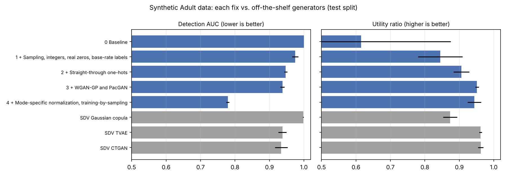

# Synthetic Tabular Data with GANs: A Rigorous Evaluation on UCI Adult

A GAN and a conditional GAN (cGAN) that generate synthetic census rows, evaluated with leakage-free splits, validity gates, real-vs-synthetic detection and train-on-synthetic / test-on-real utility. The first design was almost perfectly detectable (detection AUC 1.000). I diagnosed why, then fixed it one step at a time: the final model brings detection AUC down to **0.779** with a utility ratio of **0.944**, clearly ahead of SDV's CTGAN (0.934) and TVAE (0.938) under the same protocol.

## Why I built this

Synthetic data is increasingly used to share sensitive tables (census, medical, financial) and to augment small datasets. A data scientist needs to know whether a generator's output is good enough to use, and plausible-looking samples or a falling loss curve do not answer that.

My goals were to:

- **Build GAN and conditional GAN generators for mixed-type tabular data**, one of the harder settings for generative models because of skewed numeric columns and many categorical levels.
- **Design an evaluation that a decision-maker can trust:** leakage-free splits, validity gates before any model is selected, a detector that tries to tell real from synthetic, and a utility test that asks whether a model trained on synthetic data still works on real data.
- **Diagnose the failure, then fix it with evidence.** The first generators did not reach realistic output. I traced the causes, then added one fix at a time and measured each one on the held-out test split, so every gain is attributable to a specific change.

This tabular work complements my computer vision projects. I'm planning a follow-up that combines GAN-based generation with my face-verification pipeline.

## Highlights

- **A measured improvement ladder.** Five cumulative versions of the cGAN, each adding one fix, scored on three seeds with one shared protocol. Detection AUC falls from 1.000 to 0.779 and the utility ratio rises from 0.615 to 0.944, with zero invalid rows from step 1 on. See [Improvement ladder](#improvement-ladder).
- **Leakage-free protocol.** Each seed has three disjoint slices: fit, selection and test. One-hot levels and scalers are fit on the fit slice only. Checkpoints are chosen on the selection slice. The test split is scored once, after selection. Unit tests check that a test-only category does not add a dummy column and that a non-fit value does not change the scaler.
- **Validity before fidelity.** A checkpoint can only be selected after it passes gates for finiteness, mode collapse and plausible numeric ranges. A low generator loss is never a reason to keep a model.
- **Fidelity measured as detectability.** A random forest is trained to tell real rows from synthetic rows. A ROC-AUC of 0.5 would mean the two cannot be told apart. The original accepted models scored 0.99999 to 1.0 on held-out data; the final ladder model scores 0.779.
- **Utility measured as train-on-synthetic, test-on-real.** A classifier trained on synthetic cGAN rows reaches about 0.84 of the ROC-AUC of one trained on real rows (0.846 and 0.834 on the two accepted seeds).
- **Failure analysis, not just a score.** The unbounded (linear-output) generator failed the validity gates at learning rate 1e-3 on all six runs, mainly by producing negative capital-gain and capital-loss values. One sigmoid cGAN seed collapsed to rows with age about 90 and 99 hours per week.
- **A follow-up experiment that tests a fix.** A type-aware cGAN, with a separate output head for each column type, gets zero hard-validity violations and lower marginal distances. Detection AUC still stays above 0.99, which isolates realism, not structure, as the remaining problem.

## Improvement ladder

### Why the first design failed

Reading the original pipeline end to end turned up five concrete causes, each of which lets a detector separate real from synthetic rows:

1. **Non-integer numbers and no exact zeros.** Age and hours came out as 37.42, and capital gain was never exactly 0, while about 92% of real rows have 0. A tree detector finds that in one split.
2. **Soft versus hard one-hots.** The discriminator saw real categories as exact 0/1 vectors and fake ones as soft probabilities, so it could win without learning anything about the data.
3. **Wrong label balance.** The cGAN drew fake income labels 50/50, while about 24% of real rows earn over 50K.
4. **Argmax sampling.** The type-aware model always picked the most likely category, which collapsed rare categories and lowered coverage.
5. **Poor scaling for skewed columns and a saturated selection signal.** `fnlwgt` and the capital columns are heavy-tailed, and once the detector reached AUC 1.0 it could no longer rank checkpoints.

### The ladder

`ladder.py` trains five versions of the conditional generator. Each one keeps every change above it and adds one more:

| Step | Change |
| --- | --- |
| 0 Baseline | The published design: BCE loss, soft one-hots, 50/50 labels |
| 1 Sampling | Sample categories instead of argmax, round integer columns, a zero gate for capital gain and loss, fake labels at the real base rate |
| 2 Straight-through one-hots | The generator emits exact 0/1 one-hots in the forward pass (Gumbel-softmax with straight-through gradients), so it matches the real encoding |
| 3 WGAN-GP and PacGAN | Wasserstein loss with gradient penalty, and the critic judges packs of 10 rows at a time, which penalizes mode collapse |
| 4 Mode-specific normalization | Each numeric column is encoded by a Gaussian-mixture mode plus a position inside that mode (as in CTGAN), and training conditions on categories sampled evenly so rare ones are learned |

The same three split seeds (42, 68, 124) and the same fit, selection and test slices are used throughout. Each run keeps the checkpoint with no hard-validity violations and the lowest detection AUC on the selection slice. Then the test split is scored once: held-out detection AUC, train-on-synthetic / test-on-real utility, KS, TV and coverage.

For reference, I scored three off-the-shelf generators from [SDV](https://github.com/sdv-dev/SDV) 2.2 (Gaussian copula, CTGAN and TVAE, default settings, 300 epochs) with exactly the same protocol (`sdv_baselines.py`).

### Results on the held-out test split

Mean ± sample SD over three seeds (`results/ladder/SUMMARY.md`, per-run JSON files next to it).

| Model | Detection AUC ↓ | Utility ratio ↑ | Numeric KS ↓ | Categorical TV ↓ | Coverage ↑ | Invalid rows |
| --- | ---: | ---: | ---: | ---: | ---: | ---: |
| 0 Baseline (published design) | 1.000 ± 0.000 | 0.615 ± 0.260 | 0.736 | 0.513 | 0.315 | 6,513 |
| 1 + Sampling, integers, real zeros, base-rate labels | 0.975 ± 0.009 | 0.845 ± 0.065 | 0.157 | 0.168 | 0.592 | 0 |
| 2 + Straight-through one-hots | 0.947 ± 0.004 | 0.906 ± 0.023 | 0.143 | 0.079 | 0.844 | 0 |
| 3 + WGAN-GP and PacGAN | 0.938 ± 0.006 | 0.951 ± 0.005 | 0.112 | 0.023 | 0.944 | 0 |
| **4 + Mode-specific normalization, training-by-sampling** | **0.779 ± 0.005** | **0.944 ± 0.019** | **0.031** | 0.027 | **0.994** | **0** |
| SDV Gaussian copula | 0.998 ± 0.001 | 0.873 ± 0.021 | 0.328 | 0.015 | 0.975 | 0 |
| SDV TVAE | 0.938 ± 0.012 | 0.962 ± 0.004 | 0.164 | 0.073 | 0.792 | 0 |
| SDV CTGAN | 0.934 ± 0.018 | 0.962 ± 0.008 | 0.168 | 0.102 | 1.000 | 0 |



**What the numbers say.**

- Every step lowers detection AUC. The two largest gains come from the cheapest fixes (step 1, which removes invalid rows and lifts utility from 0.62 to 0.85) and from mode-specific normalization (step 4, which cuts detection AUC from 0.938 to 0.779 and numeric KS from 0.112 to 0.031).
- The final model is much harder to detect than SDV's CTGAN (0.779 versus 0.934) and matches its categorical marginals more closely. SDV's CTGAN and TVAE keep a small edge in utility (0.962 versus 0.944).
- Against the targets I fixed before the work (detection AUC at most 0.75, utility ratio at least 0.95, zero invalid rows), only the validity target is met. The model is close on the other two but does not pass them.
- A likely reason for the gap with SDV's CTGAN, which shares steps 3 and 4, is that SDV does not round integers or produce exact zeros. I have not tested this: post-processing SDV's output the same way would check it.

### Reusing the trained models

The selected generator of every run is saved to `models/ladder/{step}_seed{seed}.pt` (about 9 MB each, gitignored, so they are not in this repository). To draw new rows without retraining:

```python
from ladder import load_generator

sample = load_generator("models/ladder/4_ctgan_norm_seed42.pt")
rows = sample([0] * 760 + [1] * 240, seed=0)   # income labels in, decoded DataFrame out
```

## Earlier experiments

The sections below describe the original GAN and cGAN study and the first type-aware follow-up. Their numbers are the starting point that the ladder improves on.

### Original key results

Primary configuration (learning rate 1e-3, three split seeds: 42, 68, 124). The detection AUC is measured on held-out real test rows and a fresh synthetic draw. The efficacy ratio is `synthetic-trained AUC / real-trained AUC` on the real test set.

| Model | Seeds accepted by validity gates | Held-out detection AUC (mean) | Efficacy ratio |
| --- | :---: | ---: | ---: |
| GAN, linear output | 0 / 3 | - | - |
| GAN, sigmoid output | 3 / 3 | 0.999994 | n/a (no label) |
| cGAN, linear output | 0 / 3 | - | - |
| cGAN, sigmoid output | 2 / 3 | 0.999998 | 0.840 (0.846, 0.834) |

Type-aware cGAN follow-up (selection slice only, three seeds):

| Metric | Sigmoid cGAN (accepted seeds) | Type-aware cGAN |
| --- | ---: | ---: |
| Rows failing hard validity (of 5,210) | 5,210 | 0 |
| Mean numeric KS distance | 0.45 to 0.58 | 0.20 to 0.25 |
| Mean categorical total variation | 0.38 to 0.41 | 0.18 to 0.31 |
| Category coverage | 0.22 to 0.24 | 0.38 to 0.60 |
| Selection detection AUC | 0.99997 to 1.0 | 0.992 to 0.996 |

**Why this matters.** Synthetic tabular data is often reported with loss curves or a few matching histograms. This project shows why that is not enough. Models that pass basic plausibility checks and roughly match marginals are still trivially separable from real data, and they lose about 16% of downstream predictive performance. Detection AUC and train-on-synthetic / test-on-real utility are the measurements that show it.

## Repository structure

```
.
|-- main.py                   # Data loading, leakage-free splits, GAN/cGAN models, training, selection, detection, efficacy
|-- evaluator.py              # Original-domain metrics: hard validity, KS / TV fidelity, coverage, privacy proxies, detection protocols
|-- type_aware.py             # Type-aware conditional generator (Gumbel-Softmax categorical heads, typed numeric heads)
|-- run_stage2.py             # Trains and scores the type-aware cGAN on the selection slice (follow-up experiment)
|-- eval_legacy_selection.py  # Rescores the original lr 1e-3 checkpoints with evaluator.py metrics
|-- ladder.py                 # Improvement ladder: five cumulative cGAN versions, model saving, load_generator
|-- sdv_baselines.py          # SDV Gaussian copula, CTGAN and TVAE scored with the ladder protocol
|-- summarize_ladder.py       # Builds results/ladder/SUMMARY.md and the figure from the per-run JSON files
|-- repro.py                  # Reproducibility helpers: config fingerprints, environment report, checkpoint summaries
|-- experiments.ipynb         # Executed notebook for the GAN / cGAN experiments, with outputs
|-- requirements.txt          # Pinned CPU environment
|-- tests/                    # Unit tests for splits, leakage, selection, metrics and the type-aware model
`-- results/
    |-- metrics_schema.json   # Metric definitions, directions, tolerances and predeclared targets
    |-- legacy/               # Baseline records from the original runs (selection histories, run manifest, hashes)
    |-- stage1/               # Original checkpoints rescored with the extended metrics (SELECTION_REPORT.md)
    |-- ladder/               # Improvement ladder and SDV results: per-run JSON, SUMMARY.md, ladder_results.png
    `-- stage2/               # Type-aware cGAN follow-up: per-epoch history and comparison (SELECTION_REPORT.md)
```

The folder names `stage1/` and `stage2/` are kept because the scripts write to those paths. In this README they are called the **extended-metrics rescoring** and the **type-aware follow-up**.

## How to run

The UCI Adult dataset is public at the [UCI Machine Learning Repository](https://archive.ics.uci.edu/dataset/2/adult). The code expects an ARFF version of it (relation Adult, 32,561 rows, 15 attributes, target `income` with values `>50K` and `<=50K`) at `data/adult.arff`. You supply this file yourself. It is not committed, and `data/` and `*.arff` are gitignored.

```bash
python -m pip install -r requirements.txt   # torch is pinned to a CPU build; see the note below
python -m unittest discover -s tests -v     # unit tests on small fixture tables
jupyter notebook experiments.ipynb          # GAN / cGAN experiments
python eval_legacy_selection.py             # extended metrics on saved checkpoints (needs checkpoints/)
python run_stage2.py                        # type-aware cGAN follow-up (CPU, about 6.8 hours for three seeds)
python ladder.py                            # improvement ladder, all steps and seeds (CPU, several hours)
python sdv_baselines.py                     # SDV reference generators (needs: pip install sdv)
python summarize_ladder.py                  # rebuild the ladder table and figure from results/ladder/*.json
```

`requirements.txt` pins `torch==2.14.1+cpu`. If pip cannot find that build on the default index, install torch from the PyTorch CPU wheel index (`--index-url https://download.pytorch.org/whl/cpu`). Importing `main.py` does not read the ARFF or start training. Trained generators are saved under `checkpoints/`, which is gitignored and not included in this repository. Because of that, `eval_legacy_selection.py` and the reload cells in the notebook need you to train the models first.

## Methodology details

### Data

`load_adult` parses the ARFF and decodes nominal fields to strings. The token `?` stays as its own category, with no imputation. `education` is dropped and `education-num` is kept. Categorical columns are one-hot encoded in attribute order, with categories sorted. Numeric columns stay floats and are never cast to int before scaling.

Each seed (42, 68, 124) uses a stratified 80/20 train/test split, then a stratified 20% selection slice inside train. That gives 20,838 fit rows, 5,210 selection rows and 6,513 test rows, each with 92 columns after encoding. The scaler and the dummy columns are fit on the fit slice only, and the three slices are disjoint.

As a sanity check, the decoded selection-slice age means use all 5,210 rows and agree across the two scalers: 38.6503 on seed 42, 38.6188 on seed 68 and 38.3438 on seed 124 (`results/legacy/selection_age_means.json`). An earlier version of the analysis reported 39.00, 33.00 and 39.00. Those were means of the first 8 selection rows only, and an audit of the pipeline corrected them.

### Two generator heads

Both generators use two hidden blocks and a linear map to the feature width. The discriminator ends in a sigmoid. The loss is binary cross-entropy: real targets are 1, fake targets are 0, and the generator is trained to make the discriminator label fake rows as real. Discriminator steps use a detached fake batch. Adam uses `betas=(0.5, 0.999)`. Each epoch shuffles the fit rows. Logged losses are diagnostics only and do not choose the checkpoint.

- `output_activation="linear"`: no final nonlinearity. Numeric columns are standardized.
- `output_activation="sigmoid"`: adds a final sigmoid. Numeric columns are min-max scaled to `[0, 1]`. This head was rebuilt from a description of the architecture, because its original source code was not available.

All comparisons use a common decoded domain: inverse-transformed numerics and hard categorical assignments. The two scaled matrices are never compared directly.

The conditional generator concatenates the noise with a one-hot income label (2 columns). The conditional discriminator concatenates the feature row with the same one-hot vector.

### Training and checkpoint selection

Primary configuration: Adam, learning rate `1e-3`, latent size 64, hidden size 128, batch size 64, dropout 0, weight decay 0, 120 epochs. Every 10 epochs a checkpoint is scored on the full selection slice. One synthetic row is drawn per selection row, and a conditional draw uses that row's own label. The sample seed is fixed at 42, so all checkpoints in one run share the same noise.

**Validity gates.** A checkpoint is eligible when its decoded rows are finite, not collapsed, within 0.02 of the real numeric range, within 0.02 of the plausible numeric bounds, and have at most 0.25 of categorical values outside `[-0.5, 1.5]`. Collapse means diversity below 0.10, or a mean synthetic-to-real standard-deviation ratio below 0.05.

**Selection rule.** Among eligible checkpoints, the kept epoch has the smallest `abs(detection ROC-AUC - 0.5)`. The selection detector is an 80-tree random forest, depth at most 16, with 4-fold stratified cross-validation. If no checkpoint is eligible, the run has no selected model.

### Held-out evaluation

The test set is scored once, after selection.

- **Detection.** Held-out real test rows are paired with a fresh synthetic draw (seed `9000 + split seed`). Conditional labels for that draw are resampled from the fit-slice labels. The detector is a 200-tree forest scored on four stratified 50/50 holdouts, with `random_state` 124. This AUC does not pick the checkpoint.
- **Efficacy (cGAN only).** One forest is fit on decoded real fit rows and their real income labels. Another is fit on decoded synthetic rows conditioned on the fit labels. Both are scored on the decoded real test set, and the ratio is `synthetic_auc / real_auc`. The unconditional generator does not output an income label, so it has no efficacy number.

### Full results, learning rate 1e-3

Selected epochs count from 1. Means are over accepted seeds only.

| Run | Seed | Accepted | Selected epoch | Final detection AUC | Efficacy ratio |
| --- | ---: | --- | ---: | ---: | ---: |
| gan_linear | 42 | no |  |  |  |
| gan_linear | 68 | no |  |  |  |
| gan_linear | 124 | no |  |  |  |
| gan_sigmoid | 42 | yes | 110 | 0.999995 |  |
| gan_sigmoid | 68 | yes | 90 | 0.999987 |  |
| gan_sigmoid | 124 | yes | 20 | 1.000000 |  |
| cgan_linear | 42 | no |  |  |  |
| cgan_linear | 68 | no |  |  |  |
| cgan_linear | 124 | no |  |  |  |
| cgan_sigmoid | 42 | yes | 70 | 0.999997 | 0.846179 |
| cgan_sigmoid | 68 | no |  |  |  |
| cgan_sigmoid | 124 | yes | 10 | 1.000000 | 0.833801 |

Accepted `gan_sigmoid` runs: final AUC mean 0.999994 (sample std 0.000007), categorical MAE mean 0.056183 (std 0.005566), correlation MAE mean 0.211288 (std 0.039935).

Accepted `cgan_sigmoid` runs: final AUC mean 0.999998 (sample std 0.000002), efficacy ratio mean 0.83999 (std 0.008752), categorical MAE mean 0.064433 (std 0.003212), correlation MAE mean 0.169482 (std 0.045063). The real-data forests score about 0.910 (0.910487 and 0.909893). The synthetic-data forests score 0.770435 (seed 42) and 0.758670 (seed 124).

**Why the linear head failed.** Every linear checkpoint at `1e-3` failed the plausible-numeric gate. The smallest violation fractions were 0.0965, 0.0600 and 0.0748 for `gan_linear` seeds 42, 68 and 124, and 0.0393, 0.1128 and 0.1005 for `cgan_linear`. On the seed-42 checkpoints with the smallest violation, the offending columns are capital-gain and capital-loss (negative values), with a smaller share of `fnlwgt`. Categorical extremes stay near zero. Detection AUC on these invalid checkpoints is already about 1.

**A collapsed seed.** `cgan_sigmoid` seed 68 never passed. Its least-implausible checkpoint (epoch 10) has plausible violation 0, categorical extreme 0, diversity 0.7313 and numeric mean shift 2.1446. Decoded rows sit near age 90, education-num 16 and 99 hours per week, which the standard-deviation gate flags as collapse.

**Detector saturation.** Eligible sigmoid checkpoints have selection ROC-AUC at or just under 1, so `abs(AUC - 0.5)` is about 0.5. The kept epoch is the eligible checkpoint with the smallest full-precision gap, not the first eligible checkpoint. Ties keep the earlier epoch because the comparison is strict. The first eligible epoch is 10 on every accepted run, and four of the five selected epochs come later. Only `cgan_sigmoid` seed 124 stays at epoch 10, because every later eligible gap is exactly 0.5. The gaps that break these ties are on the order of 1e-6 to 3e-5 (`results/legacy/checkpoint_records.json`). Once the detector saturates, this ranking carries almost no information. A gap near 0.5 here means the forest separates real and synthetic rows.

### Learning-rate follow-up (1e-4)

This run makes one change to the primary configuration: Adam learning rate `1e-4`, with the same widths, batch size and 120 epochs. It was run for `gan_linear` and `cgan_linear` at seed 42. Because `cgan_linear` seed 42 produced an eligible checkpoint, it was then run on seeds 68 and 124 too. It was also run for the collapsed `cgan_sigmoid` seed 68.

| Run | Seed | Accepted | Selected epoch | Final detection AUC | Efficacy ratio | Plausible violation |
| --- | ---: | --- | ---: | ---: | ---: | ---: |
| gan_linear | 42 | no |  |  |  | 0.1155 |
| cgan_linear | 42 | yes | 10 | 1.0 | 0.844296 | 0.0169 |
| cgan_linear | 68 | no |  |  |  | 0.0935 |
| cgan_linear | 124 | yes | 20 | 1.0 | 0.929290 | 0.0140 |
| cgan_sigmoid | 68 | yes | 10 | 1.0 | 0.596872 | 0.0 |

The lower learning rate makes more runs pass the gates, but every accepted draw is still perfectly detectable. The recovered `cgan_sigmoid` seed 68 checkpoint has an efficacy ratio of 0.596872 (real 0.908037, synthetic 0.541982) and a numeric mean shift of 2.91.

### Extended-metrics rescoring of the original checkpoints

`evaluator.py` adds metrics that judge **hard validity** separately from **distributional fidelity**, all computed in the original data domain:

- Hard validity: integer columns are integers, values are in domain, capital values are non-negative, categories are valid.
- Per-column KS distance and categorical total variation (TV).
- Category coverage and rare-category recall.
- Correlation error.
- Duplicate and nearest-neighbor privacy proxies.

Tolerances were fixed from the inverse-transform error of real rows before any generator was scored. Real selection rows have 0 hard-validity violations. The metric definitions and the predeclared targets are in `results/metrics_schema.json`. A success claim needs all three targets: zero hard-validity violations, held-out detection AUC at most 0.75, and utility ratio at least 0.95.

All 12 primary checkpoints were rescored on the selection slice (`results/stage1/SELECTION_REPORT.md`). Every checkpoint fails hard validity. Accepted sigmoid checkpoints fail the integer check on all 5,210 rows. Detection AUC is 0.999974 to 1.0. Category coverage on accepted sigmoid runs is 0.22 to 0.35, and rare-category recall is 0 on four of the five. No synthetic row is an exact copy of a fit row. The test split was not used for this rescoring.

### Type-aware cGAN follow-up

`type_aware.py` defines a new generator, `TypeAwareConditionalGenerator`. It does not change the original classes:

- Each categorical attribute gets its own Gumbel-Softmax head, with the temperature annealed linearly from 1.0 to 0.5.
- `education-num` gets its own discrete head.
- Age and hours are bounded continuous outputs, rounded to integers at sampling time.
- Capital gain and loss use a zero gate plus a positive magnitude.

It uses the same splits as the sigmoid cGAN, the same optimizer and widths, and a BCE conditional discriminator, trained for 120 epochs on three seeds (`python run_stage2.py`). Scoring uses the selection slice only. The comparison epoch follows a rule declared before the run: lowest violation fraction, then the lowest mean of KS and TV, then the lowest detection AUC, then the earlier epoch.

| Seed | Epoch | Violations | KS mean | TV mean | Coverage | Rare recall | Detection AUC |
| ---: | ---: | ---: | ---: | ---: | ---: | ---: | ---: |
| 42 | 70 | 0 | 0.2019 | 0.3103 | 0.378 | 0.0000 | 0.9959 |
| 68 | 120 | 0 | 0.2466 | 0.2975 | 0.495 | 0.0465 | 0.9964 |
| 124 | 110 | 0 | 0.2429 | 0.1775 | 0.604 | 0.0233 | 0.9919 |

Every scored checkpoint had zero hard-validity violations. The structural hypothesis is supported: typed output heads make the rows valid by construction, and KS, TV and coverage all improve over the sigmoid cGAN. The fidelity hypothesis is not supported: detection AUC stays above 0.99 on every seed and epoch, and rare categories are still almost never generated. Per-epoch scores are in `results/stage2/history.jsonl` and `results/stage2/comparison.json`.

## Limitations

- `?` remains a category, so a dummy column can mean "missing".
- The sigmoid head is a reconstruction, not the original code.
- Three seeds on one table, with fixed network widths, is a small sample. There was no hyperparameter search.
- Selecting by detection gap stops ranking checkpoints once the detector saturates.
- The linear head at `1e-3` produced no acceptable model.
- The held-out detector is fit on half of a pool of real test rows plus synthetic rows. It is not a detector trained only on development data and then applied to untouched test data. The test split has now been used for these published numbers.
- The ladder uses one table, three seeds and one set of hyperparameters per step, with no tuning. Steps were added in one fixed order, so an effect that depends on order is not measured.
- Held-out detection and utility were not run for the first type-aware cGAN. Its results are on the selection slice only, so they are not directly comparable with the held-out table above.

## What I would try next

- **Close the last gap to the targets** (detection AUC at most 0.75, utility at least 0.95): longer training and a small hyperparameter search for step 4, which was run with fixed settings.
- **Test where the edge over SDV comes from** by applying the same rounding and exact-zero handling to SDV's CTGAN output.
- **Privacy checks** on the final model (distance to the closest real row, membership inference), since better fidelity can mean more memorization.
- **Combine this with my face-verification work**: use conditional generation to augment under-represented groups and measure the effect on verification error.

---

Author: Dor Meir
