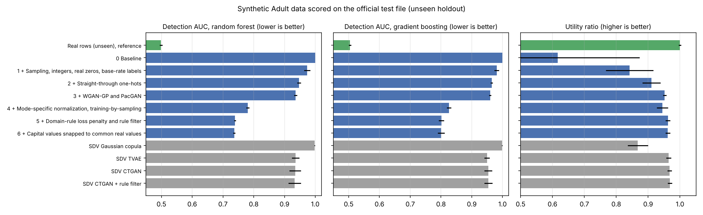

# Synthetic Tabular Data with GANs on UCI Adult

A conditional GAN that generates realistic synthetic census rows, evaluated on 16,281 real rows it has never seen. With a random-forest detector, synthetic rows reach a detection AUC of **0.739**, where 0.5 means indistinguishable and 1.0 means always caught. Synthetic data keeps **96%** of real-data utility, every row satisfies the domain rules, and there is no sign of memorization. Under the same protocol, SDV's CTGAN scores 0.935 and TVAE 0.937.

## Why I built this

Synthetic data is used to share sensitive tables (census, medical, financial) and to augment small datasets. Before anyone uses it, a data scientist has to answer two questions: is it realistic, and is it useful? Plausible-looking samples or a falling loss curve answer neither.

This project builds a tabular generator and an evaluation that answers both:

- **Realism** is measured as detectability. Two different classifiers try to tell real rows from synthetic rows.
- **Usefulness** is measured by training a model on synthetic data and testing it on real data.
- **Safety** is checked by testing whether synthetic rows sit closer to the training rows than to unseen real rows.

Every design change is added one at a time and measured, so each gain can be traced to a specific change.

This tabular work complements my computer vision projects. I'm planning a follow-up that combines conditional generation with my face-verification pipeline.

## Results

All numbers are on the official Adult test file (16,281 rows). No model, rule or threshold was fit or chosen on it. Values are the mean ± SD over three split seeds. The first row uses real rows the models never trained on, which is the best score any generator could reach.

| Model | Detection AUC, forest ↓ | Detection AUC, boosting ↓ | Utility ratio ↑ | Numeric KS ↓ | Rule-breaking rows | Closer to training rows (0.5 = no memorization) |
| --- | ---: | ---: | ---: | ---: | ---: | ---: |
| Real unseen rows (reference) | 0.499 ± 0.005 | 0.504 ± 0.004 | 1.000 | 0.015 | 0% | 0.501 |
| 0 Baseline cGAN | 1.000 ± 0.000 | 1.000 ± 0.000 | 0.617 | 0.737 | 41.7% | 0.607 (unstable) |
| 1 + Sampling, integers, real zeros, base-rate labels | 0.974 ± 0.010 | 0.981 ± 0.008 | 0.842 | 0.154 | 0.2% | 0.508 |
| 2 + Straight-through one-hots | 0.947 ± 0.006 | 0.965 ± 0.004 | 0.910 | 0.140 | 0.2% | 0.501 |
| 3 + WGAN-GP and PacGAN | 0.936 ± 0.005 | 0.960 ± 0.003 | 0.952 | 0.109 | 7.2% | 0.492 |
| 4 + Mode-specific normalization, training-by-sampling | 0.781 ± 0.005 | 0.826 ± 0.007 | 0.945 | 0.029 | 7.1% | 0.498 |
| **5 + Domain-rule loss and rule filter (final)** | **0.739 ± 0.003** | **0.801 ± 0.008** | **0.962** | 0.035 | **0%** | **0.497** |
| 6 = 5 + capital values snapped to common real values | 0.737 ± 0.004 | 0.800 ± 0.011 | 0.962 | 0.035 | 0% | 0.496 |
| SDV Gaussian copula | 0.998 ± 0.001 | 0.999 ± 0.001 | 0.868 | 0.326 | 33.2% | 0.484 |
| SDV TVAE | 0.937 ± 0.012 | 0.950 ± 0.009 | 0.964 | 0.161 | 3.0% | 0.491 |
| SDV CTGAN | 0.935 ± 0.019 | 0.953 ± 0.013 | 0.967 | 0.168 | 8.1% | 0.519 |



Full table, including categorical TV and the extra control runs: `results/holdout/SUMMARY.md`.

**What the results show**

- **Targets fixed before the work:** detection AUC at most 0.75, utility at least 0.95, and zero invalid rows. Step 5 meets all three with the random-forest detector. A stronger gradient-boosting detector still separates the data better (0.801), so there is room left.
- **Biggest gains:** mode-specific normalization (step 4) and the domain rules (step 5).
  - The rules add more than a filter alone. Filtering rule-breaking rows from step 4 at sampling time gives 0.767. Training with the rule penalty as well gives 0.739, and the share of rows the filter has to redraw falls from 7% to about 2%.
- **No memorization:** in every model, synthetic rows are as close to unseen real rows as to training rows (about 0.5), and none is an exact copy of a training row.
- **Snapping capital values adds nothing measurable** (0.737 vs 0.739, within seed noise). The threshold chosen on the selection slice also differs between seeds (5, 10 and 20), because the scores for different thresholds are within noise. So the final model is step 5, where everything except the domain rules is learned, and no rule copies values from the data.
- **The gap to SDV CTGAN is not about rules.** Applying the same rule filter to SDV CTGAN leaves it at 0.933.

## Method

### Data and splits

- **Dataset:** UCI Adult, 32,561 rows used for training. `education` is dropped and `education-num` is kept. `?` stays as its own category.
- **Splits:** for each seed (42, 68, 124) the 32,561 rows are split into a fit slice (20,838 rows), a selection slice (5,210) and an internal test split (6,513).
- **What each slice is for:**
  - Encoders and models are fit on the fit slice only.
  - Checkpoints and the snap threshold are chosen on the selection slice.
  - The internal test split was used to study which rows the detector catches. Because of that, the results above use the separate official test file.

### The generator (step 5)

- **Conditioning:** a conditional WGAN-GP on income. The critic judges packs of 10 rows (PacGAN), and the generator emits straight-through Gumbel-softmax one-hots, so its categories are exact 0/1 like real rows.
- **Numeric columns:** each is encoded as a Bayesian Gaussian-mixture mode plus a position inside that mode, as in CTGAN. `capital-gain` and `capital-loss` add a zero/non-zero gate. Integer columns are rounded.
- **Training-by-sampling:** training conditions on categories sampled by log-frequency, so rare categories are learned.
- **Domain rules** come from what the fields mean, not from fitted numbers:
  - a husband is a married man, and a wife is a married woman;
  - occupation is missing exactly when workclass is missing or "Never-worked".

  In all 48,842 Adult rows the last two rules have no exceptions and the first has 4. The generator is trained with a penalty equal to the expected number of broken rules, computed from its category probabilities. At sampling time, any row that still breaks a rule is redrawn for the same label.
- **Checkpoint selection:** the kept epoch has zero hard-validity violations and the lowest cross-validated detection AUC on the selection slice.

### Evaluation

- **Detection:** a random forest (200 trees) and a gradient-boosting classifier are each trained on selection rows vs. one synthetic draw. They are then scored on the test-file rows vs. a fresh draw.
- **Utility:** one random forest is trained on real fit rows and another on an equal number of synthetic rows. Both are scored on the test file. The ratio is `synthetic AUC / real AUC`.
- **Fidelity:** per-column KS for numeric columns, total variation for categorical columns, and category coverage.
- **Memorization:** each of 5,000 synthetic rows is compared with its nearest training row and its nearest test-file row, on standardized features. The table shows the share of synthetic rows that sit closer to the training rows. About 0.5 means the model generalizes rather than copies.

## Repository structure

```
.
|-- ladder.py               # Generator, training, domain rules, step definitions, load_generator
|-- evaluate_holdout.py     # Scores every model on the official test file (two detectors, utility, memorization)
|-- summarize_holdout.py    # Builds results/holdout/SUMMARY.md and the figure
|-- sdv_baselines.py        # SDV reference generators on the internal test split
|-- summarize_ladder.py     # Summary of the internal test split results
|-- evaluator.py            # Metrics: hard validity, KS / TV, coverage, detection protocols, utility
|-- main.py                 # Data loading, leakage-free splits, baseline GAN / cGAN
|-- type_aware.py, run_stage2.py, eval_legacy_selection.py, experiments.ipynb   # baseline GAN / cGAN study
|-- tests/                  # Unit tests for splits, leakage, selection and metrics
`-- results/
    |-- holdout/            # Main results: per-run JSON, SUMMARY.md, holdout_results.png
    |-- ladder/             # Internal test split results for steps 0-5 and SDV
    `-- legacy/, stage1/, stage2/, metrics_schema.json   # baseline study records
```

## How to run

You need two data files, both public at the [UCI Machine Learning Repository](https://archive.ics.uci.edu/dataset/2/adult). Neither is committed (`data/` is gitignored).

- `data/adult.arff`: the 32,561 training rows, in ARFF format.
- `data/adult_test.csv`: the official `adult.test` file, either as published or as a plain CSV.

```bash
python -m pip install -r requirements.txt
python -m unittest discover -s tests -v
python ladder.py                 # train steps 0-5 on three seeds (CPU, about 1 hour per step-4/5 run)
python evaluate_holdout.py       # score everything on the test file (fits SDV models if missing)
python summarize_holdout.py      # rebuild the table and figure
```

`requirements.txt` pins `torch==2.14.1+cpu`. If pip cannot find that build, use the PyTorch CPU wheel index (`--index-url https://download.pytorch.org/whl/cpu`).

### Reusing a trained model

The selected generator of every run is saved to `models/ladder/{step}_seed{seed}.pt`, about 9 MB each. These files are not in the repository. To draw new rows without retraining:

```python
from ladder import load_generator

sample = load_generator("models/ladder/5_rules_seed42.pt")
rows = sample([0] * 760 + [1] * 240, seed=0)   # income labels in, decoded DataFrame out
```

## Limitations

- One table, three seeds and fixed hyperparameters per step. There was no tuning, and the penalty weight is fixed at 1.
- Steps were added in one fixed order, so effects that depend on order are not measured.
- The domain rules are specific to Adult. They are kept in one function (`rule_violations`), separate from the model.
- A gradient-boosting detector still reaches 0.80, so the synthetic rows are not indistinguishable from real ones.
- The memorization check is a distance test, not a formal privacy guarantee.

## What I would try next

- Close the gap the boosting detector still finds: longer training, a small search over the penalty weight and the network width, and a look at which rows it catches.
- Formal privacy checks (membership inference, differential privacy training).
- Combine this with my face-verification work: conditional generation to balance under-represented groups, measured by its effect on verification error.

---

Author: Dor Meir
